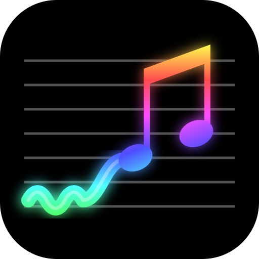
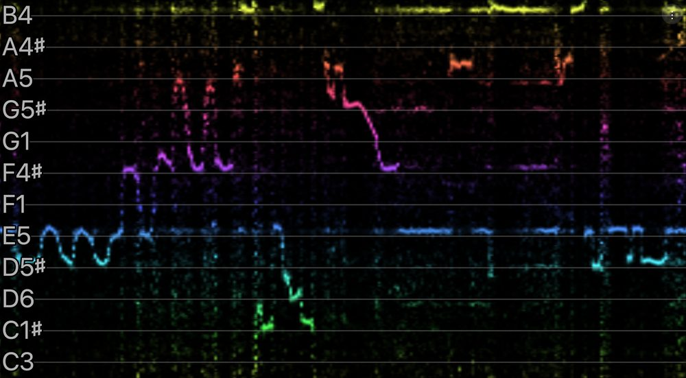

  

<h1 align="center">Pitch Spectrogram</h1>

A live, octave-wrapped pitch spectrogram that works locally on the browser.

Serve the folder with any static web server (microphone access needs
`localhost` or HTTPS), for example `python3 -m http.server`, then tap to
start.

Live demo is hosted at: https://abpaudel.com/pitch-spectrogram/.

## What it shows

12 rows, C at the bottom and B at the top, with time scrolling right to
left and each pitch class drawn in its own hue. Every octave is folded into
one row band, so a trace's height shows its pitch class and the row label
shows the octave it was last heard in.

## How it works

- Hann-windowed FFT with frequency reassignment, spread onto 3072
  log-frequency bins (32 per semitone, C0 to C8).
- Background subtraction, harmonic salience boost and subharmonic
  suppression, then the 8 octaves are folded into one (maximum).
- A 30 dB level gate scales each column by the input loudness.
- The display is a 256 x 384 ring-buffer texture: one column per analysis
  frame, pixel = row colour x level.

## Files

| File | Role |
|---|---|
| `js/dsp.js` | Spectral analysis of one frame |
| `js/worker.js` | Resampling, framing, octave label tracking |
| `js/view.js` | WebGL ring-buffer texture, guide lines, labels |
| `js/capture-worklet.js` | Microphone capture (ScriptProcessor fallback in `app.js`) |
| `js/app.js` | Wiring, options, persistence |

## Options

- **Analysis Sensitivity**: Low, Medium or High (input boost of -6, +6 or +18 dB
  before the level gate).
- **Analysis Rate**: Low, Medium or High (21.5, 43 or 86 columns per second).
- **Sample Rate**: 11025, 22050 or 44100 Hz.
- **Note names**: sharps (default), flats, or C♯ E♭ F♯ G♯ B♭.
- **Calibration**: the A4 reference frequency.

The button below the menu toggles full screen and keeps the screen awake
while in it (where the browser supports it).
